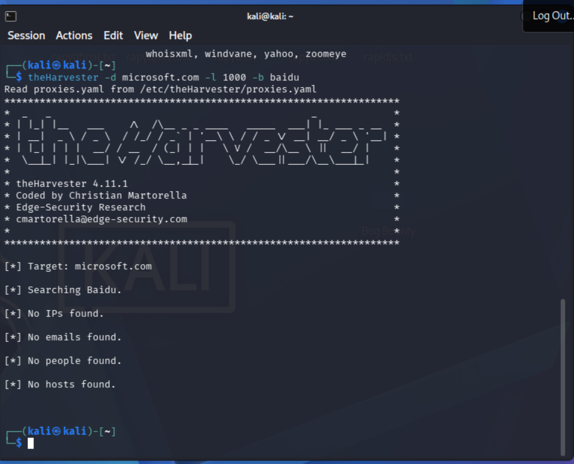
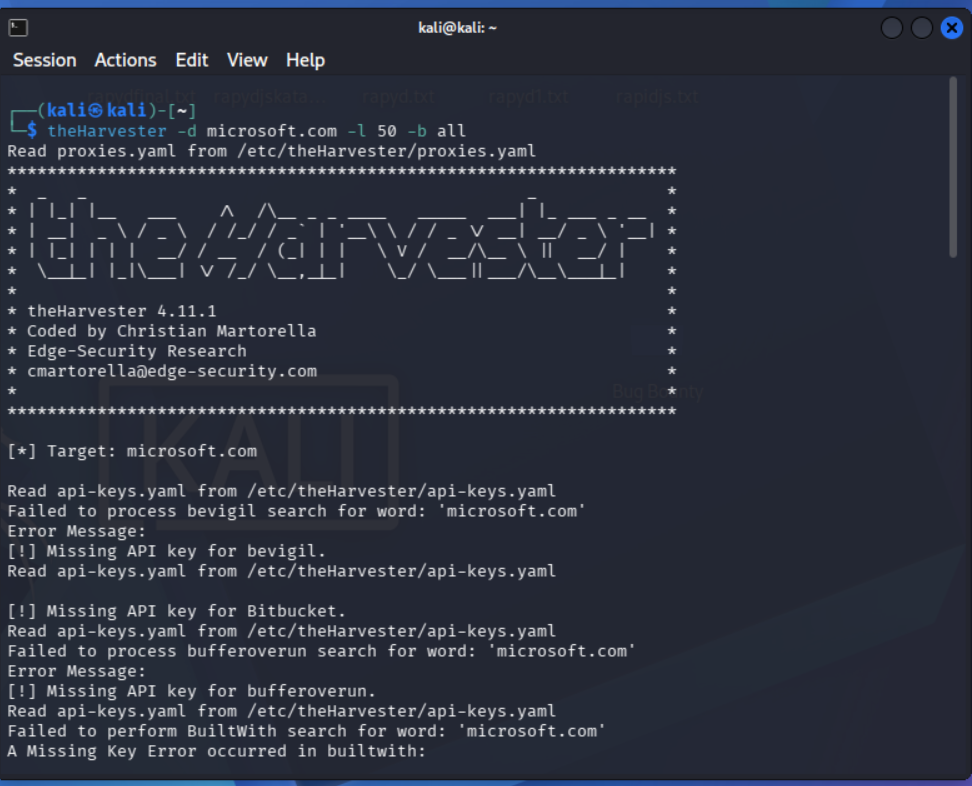

# Module 4 – Footprinting with theHarvester

**Internship:** [Networkwalks-cybersecurity]
**Intern:** [Awais Sajjad]
**Week:** 2

> Performed for educational purposes only, using theHarvester's public
> OSINT sources against microsoft.com.

## Objective
Gather email IDs and subdomains related to the target organization
**microsoft.com** using theHarvester on Kali Linux, comparing a single
source (Baidu) against all available sources.

## Tool
theHarvester v4.11.1 (pre-installed on Kali Linux)

---

## Task 1: Baidu Source, Limit 1000

**Command:**
```bash
theHarvester -d microsoft.com -l 1000 -b baidu
```

**Screenshot:**


**Raw output:** [`outputs/task1-baidu.txt`](outputs/task1-baidu.txt)

**Result:**
[] Target: microsoft.com
[] Searching Baidu.
[] No IPs found.
[] No emails found.
[] No people found.
[] No hosts found.


**Findings:**
Baidu returned **zero results** for microsoft.com — no IPs, emails,
hosts, or people. This is expected: Baidu is a Chinese search engine that
indexes mostly Chinese-language content, so it rarely has useful data on
large Western tech companies. It shows that **source selection matters
as much as the query itself** in OSINT gathering.

---

## Task 2: All Sources, Limit 50

**Command:**
```bash
theHarvester -d microsoft.com -l 50 -b all
```

**Screenshot:**


**Raw output:** [`outputs/task2-all-sources.txt`](outputs/task2-all-sources.txt)

**Result summary:**

| Category | Count |
|----------|-------|
| ASNs found | 7 |
| Interesting URLs found | 5 |
| IPs found | 149 |
| Emails found | 3 |
| Hosts/subdomains found | 816 |

**Emails found:**
dotnet-docker-bot@microsoft.com
opencode@microsoft.com
secure@microsoft.com


**ASNs found:**
AS13335, AS133618, AS16509, AS206834, AS396982, AS40034, AS8075


**Sample subdomains found (816 total — see raw output for full list):**
azure.microsoft.com
learn.microsoft.com
careers.microsoft.com
security.microsoft.com
login.microsoft.com
copilot.microsoft.com
teams.microsoft.com (and hundreds of regional/service sub-subdomains)


**Notes on sources used:**
Many premium sources (Shodan, VirusTotal, Censys, SecurityTrails,
Hunter, BuiltWith, etc.) returned **"Missing API key"** errors since no
paid API keys were configured — these were skipped automatically.
Results still came through free/no-key sources: Baidu, Certspotter,
Chaos, DuckDuckGo, Commoncrawl, Hackertarget, Hudson Rock, CRTsh, Mojeek,
OTX, Rapiddns, Robtex, Windvane (DNS fallback), Yahoo, and
Wayback Archive.

Hudson Rock's module also reported broader statistics unrelated to the
limit (621,809 total compromised records and 16,601 employees associated
with the domain across past breaches) — included here as context, not as
part of the 50-result limit.

---

## Comparison

| Criteria | Baidu only (limit 1000) | All sources (limit 50) |
|----------|---------------------------|---------------------------|
| Subdomains/hosts found | 0 | 816 |
| Emails found | 0 | 3 |
| IPs found | 0 | 149 |
| Effectiveness | None — wrong source for this target | High — certificate transparency (Certspotter/CRTsh) and DNS-based sources did the heavy lifting |

## Summary
Running theHarvester with a single mismatched source (Baidu) against a
large US-based organization returned nothing, while running it against
**all** available free sources — even with a much lower result limit (50
vs 1000) — surfaced 816 subdomains, 149 IPs, and 3 valid email addresses.
This demonstrates that **source breadth matters more than the per-source
result limit**: certificate transparency logs (crt.sh, Certspotter) and
passive DNS sources are far more productive for large enterprise domains
than general web search engines.

## Key Takeaway
Even without any paid API keys, free OSINT sources alone exposed
hundreds of Microsoft's internal and service subdomains along with
working contact emails — information a real attacker could use for
reconnaissance before a social engineering or infrastructure-mapping
attempt. This highlights why organizations monitor their own certificate
transparency logs and public DNS footprint regularly.
