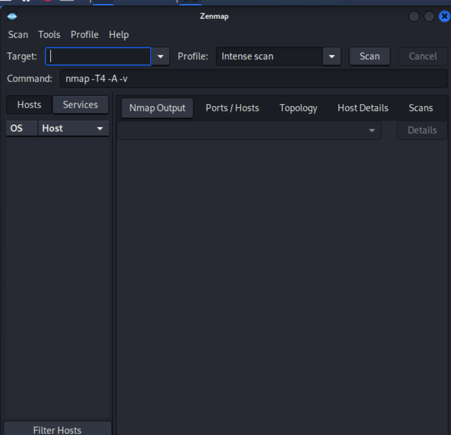
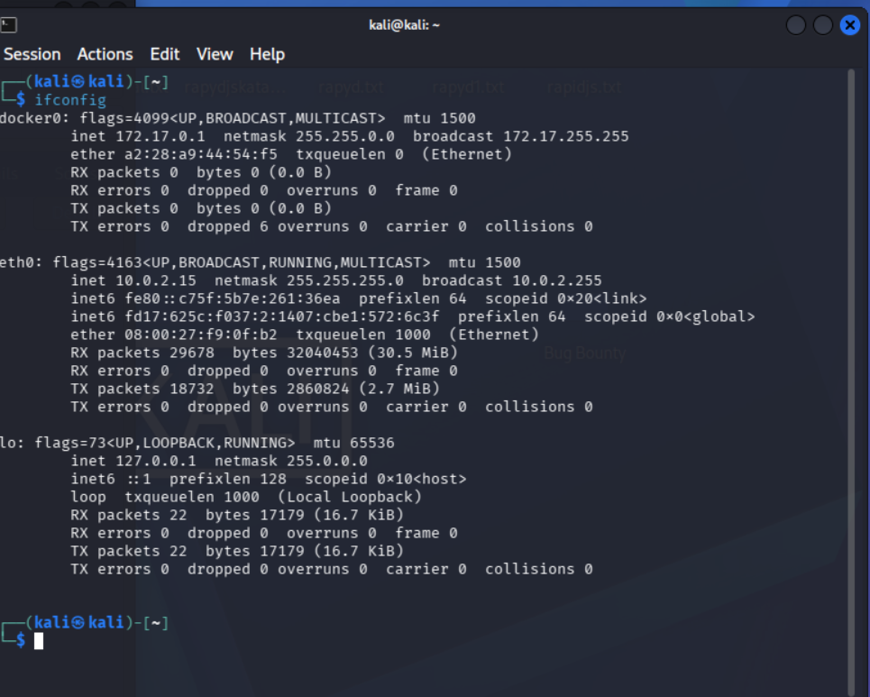
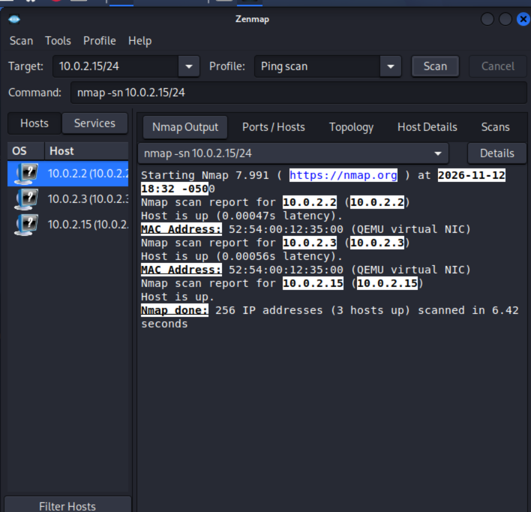

# Module 5 – Network Scanning with Zenmap

**Internship:** [Networkwalks-Cybersecurity]
**Intern:** [Awais Sajjad]
**Week:** 2

> Performed on my own local/virtual network for educational purposes only.

## Objective
Install Zenmap and use it to discover the local IP subnet, enumerate live
hosts on that subnet, and export the scan topology as a PDF.

## Task 1: Install Zenmap

**Note on environment:** The task specified installing Zenmap on a
Windows PC. Since Zenmap comes **pre-installed on Kali Linux**, I used
the pre-installed version (Zenmap GUI, using Nmap 7.991 as its backend)
instead of a separate Windows install.

**Screenshot — Zenmap launched, ready to scan:**


The GUI opened successfully with the **Intense scan** profile selected
by default and the target field empty, confirming the installation was
working correctly before any scan was run.

---

## Task 2: Find Local IP Address & LAN Subnet

**Command:**
```bash
ifconfig
```

**Screenshot:**


**Findings:**
- **Local IP address:** `10.0.2.15`
- **Netmask:** `255.255.255.0`
- **LAN subnet:** `10.0.2.0/24`
- Interface: `eth0`, MAC `08:00:27:f9:0f:b2`

---

## Task 3: Find Live Hosts in the Subnet

**Command (via Zenmap, Ping scan profile):**
```bash
nmap -sn 10.0.2.15/24
```

**Screenshot:**


**Output:**
Starting Nmap 7.991 (https://nmap.org) at 2026-11-12 18:32 -0500
Nmap scan report for 10.0.2.2
Host is up (0.00047s latency).
MAC Address: 52:54:00:12:35:00 (QEMU virtual NIC)
Nmap scan report for 10.0.2.3
Host is up (0.00056s latency).
MAC Address: 52:54:00:12:35:00 (QEMU virtual NIC)
Nmap scan report for 10.0.2.15
Host is up.
Nmap done: 256 IP addresses (3 hosts up) scanned in 6.42 seconds

---

## Task 4: Number of Live Hosts

**Answer: 3 hosts** were found live in the `10.0.2.0/24` subnet (out of
256 scanned addresses).

---

## Task 5: IP Addresses of Live Hosts

| # | IP Address | Notes |
|---|------------|-------|
| 1 | 10.0.2.2 | Virtual network gateway (QEMU/VirtualBox NAT) |
| 2 | 10.0.2.3 | Virtual DNS/host interface (QEMU/VirtualBox) |
| 3 | 10.0.2.15 | My own Kali machine (scan source) |

---

## Task 6: MAC Addresses of Live Hosts

| # | IP Address | MAC Address | Vendor |
|---|------------|-------------|--------|
| 1 | 10.0.2.2 | 52:54:00:12:35:00 | QEMU virtual NIC |
| 2 | 10.0.2.3 | 52:54:00:12:35:00 | QEMU virtual NIC |
| 3 | 10.0.2.15 | — (own interface, MAC not reported by Nmap for the scanning host itself) | — |

**Note:** Both `10.0.2.2` and `10.0.2.3` show the same MAC address
(`52:54:00:12:35:00`). This is expected in a virtualized/NAT lab
environment (VirtualBox/QEMU), where the hypervisor presents multiple
virtual IPs behind a single virtual NIC — it does not indicate a real
duplicate device on a physical network.

---

## Task 7: Topology Output (PDF)

A second ping scan was re-run to confirm consistent results before
exporting:

**Screenshot — repeat scan confirming same 3 live hosts:**


**Topology export:** Saved via **Zenmap → Topology tab → Save Graphic →
PDF**, exported to the Desktop.

📄 [View exported topology PDF](zenmap.pdf) — lists the discovered hosts:
10.0.2.15 (10.0.2.15)
10.0.2.3
10.0.2.2
localhost

---

## Summary
A simple ping scan (`-sn`) across my local `/24` subnet identified all 3
active hosts in this virtualized lab network: my own Kali machine and two
virtual gateway/host-interface addresses provided by the hypervisor.
Zenmap's GUI made it straightforward to visualize this as both a host
list and an exportable topology diagram, without needing to memorize raw
Nmap syntax.

## Key Takeaway
Network scanning tools like Zenmap/Nmap are fast and effective for
building an accurate inventory of what's actually live on a network —
useful both offensively (reconnaissance) and defensively (spotting
unauthorized or unexpected devices on your own network).
